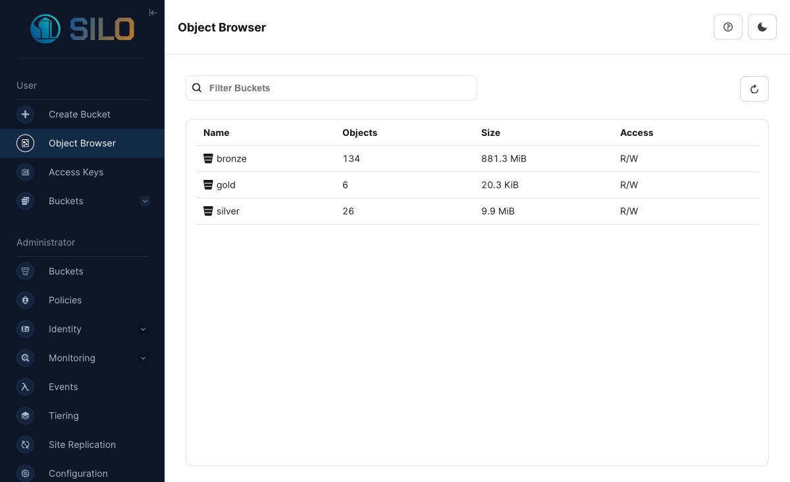
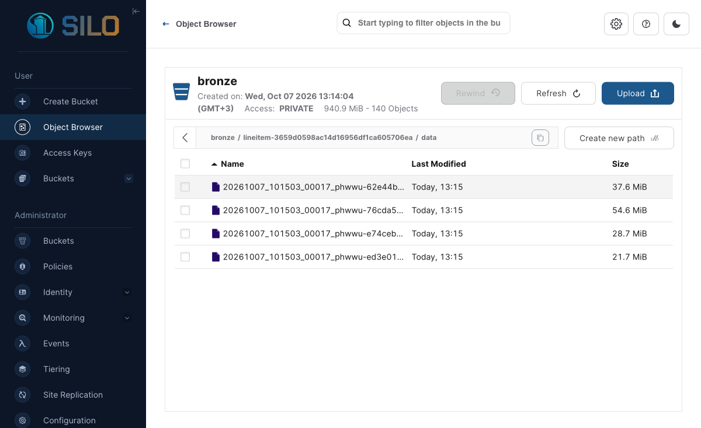
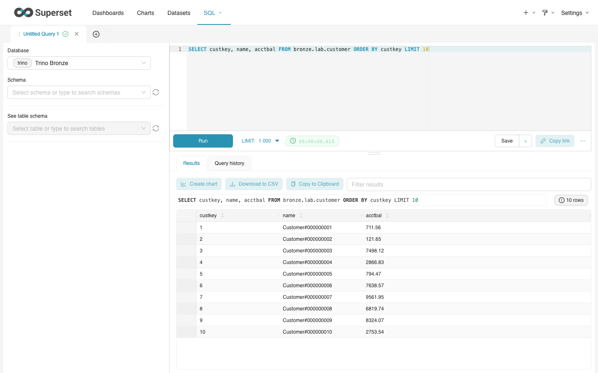

# Отчёт по практической работе № 1

**Левченков Артемий Викторович · вариант 2 · TPC-H Q10 «Returned Item Reporting»**

В этой работе я поднял локальный Lakehouse, загрузил данные TPC-H в Bronze, собрал Silver и Gold и сравнил форматы хранения. Замеры выполнил 7 октября 2026 года на этом стенде. Количество строк проверял через `count(*)`, а размер файлов считал по `file_size_in_bytes` в Iceberg `"table$files"` для текущего снапшота. Размер в таблицах указан в MiB (2²⁰ байт). Код загрузки и измерений находится в `scripts/run_lab.py` и `scripts/trino_client.py`.

## 1. Вариант и масштаб

| Поле | Значение |
|---|---|
| ФИО (как в VK Education) | Левченков Артемий Викторович |
| Вариант (запрос) | № 2, Q10 «Returned Item Reporting» |
| Масштаб `sfN` | `sf1` |
| Почему выбрал такой масштаб | В `sf1` одна таблица `lineitem` уже содержит 6 001 215 строк. Этого хватило, чтобы увидеть разницу в размере файлов и времени запроса. На моём Mac 16 ГБ памяти; больший масштаб занял бы заметно больше места и времени. Во всех слоях и опытах использован один `sf1`. |

Q10 показывает 20 клиентов, которые принесли больше всего выручки от возвращённых товаров по заказам IV квартала 1993 года. Выручку каждой позиции считал как `extendedprice × (1 − discount)`. Дата `1994-01-01` в квартал уже не входит.

## 2. Поднятые сервисы — и почему именно они

| Сервис | Роль в стеке | Почему именно он |
|---|---|---|
| MinIO-совместимый Silo (`pgsty/minio`) | S3-хранилище для трёх бакетов | Файлы лежат отдельно от Trino, доступ к ним идёт через S3 API. Образ `quay.io/minio/minio:latest` у меня не скачался (`401`), поэтому использовал совместимый форк. |
| PostgreSQL 17 | Хранит служебные данные Lakekeeper | Lakekeeper поддерживает PostgreSQL и сохраняет в нём состояние каталога между перезапусками. |
| Lakekeeper | REST-каталог Iceberg | Здесь находятся сведения о таблицах и их версиях; Trino получает их из каталога. |
| Trino 476 | SQL-запросы и источник TPC-H | Встроенный коннектор `tpch` генерирует `sf1`, а Iceberg-коннектор записывает Parquet и ORC в S3. |
| Superset | Просмотр Bronze через Trino | В SQL Lab можно выполнить запрос к загруженным таблицам и увидеть результат. |

Стек поднимал такими командами (полная последовательность есть в `README.md`):

```bash
python3 scripts/setup_local.py                         # локальные настройки и пароли
docker compose up -d minio postgres lakekeeper trino   # хранилище, база, каталог и SQL-движок
docker compose run --rm minio-init                      # бакеты bronze, silver, gold
python3 scripts/setup_local.py --register              # регистрация трёх warehouse
docker compose restart trino                            # перечитать настройки каталогов
docker compose --profile bi up -d --build superset     # BI-интерфейс
```

S3 доступен на порту `9000`, интерфейс хранилища — на `19001`, Lakekeeper — на `8181`, Trino — на `8080`, Superset — на `18088`. Вывод `docker compose ps` и снимки экранов лежат в `evidence/`.



Размер всего бакета Bronze на снимке больше суммы четырёх основных таблиц: там также лежат четыре набора для бенчмарка и служебные файлы Iceberg. Числа ниже относятся только к файлам текущих снапшотов самих таблиц.

## 3. Разбор запроса — какие данные нужны

| Таблица TPC-H | Нужные колонки | Что запрос с ними делает |
|---|---|---|
| `customer` | `custkey`, `name`, `acctbal`, `nationkey`, `address`, `phone`, `comment` | По `custkey` нахожу заказы клиента, по `nationkey` — его страну; остальные поля нужны в ответе. |
| `orders` | `orderkey`, `custkey`, `orderdate` | По `orderkey` нахожу позиции заказа, по `orderdate` оставляю IV квартал 1993 года. |
| `lineitem` | `orderkey`, `linenumber`, `extendedprice`, `discount`, `returnflag` | Беру позиции с флагом возврата `R` и считаю выручку. `linenumber` использую при проверке уникальности строк. |
| `nation` | `nationkey`, `name` | Добавляю название страны клиента. |

Прямой запрос для проверки лежит в `sql/q10_reference.sql`. В Bronze я оставил все столбцы исходных таблиц: если понадобится другая витрина, данные не придётся загружать заново.

## 4. Медальон — решения по каждому слою

Для Bronze, Silver и Gold созданы отдельные бакеты и Iceberg warehouse. Партиции не делал: при масштабе `sf1` они добавили бы мелких файлов, а нужный квартал всё равно отбирается в Silver. Основные таблицы записал в Parquet, потому что Q10 читает только часть столбцов. Для Bronze выбрал GZIP, чтобы уменьшить объём исходных данных, которые редко меняются. Для рабочих таблиц Silver использовал ZSTD, а для небольшой витрины Gold — Snappy; разница между кодеками на 20 строках почти не важна. Кодек задаётся сессионным свойством Trino `{catalog}.compression_codec`, формат — свойством таблицы `format`.

### Bronze (сырой)

| Таблица | Колонки (что оставил) | Строк | Вес, MiB | Формат | Сжатие | Партиционирование | Обоснование |
|---|---|---:|---:|---|---|---|---|
| `customer` | custkey, name, address, nationkey, phone, acctbal, mktsegment, comment | 150 000 | 7.673 | PARQUET | GZIP | нет | Оставил все поля исходной таблицы, чтобы потом можно было собрать другую витрину. Для этого объёма партиции не нужны. |
| `orders` | orderkey, custkey, orderstatus, totalprice, orderdate, orderpriority, clerk, shippriority, comment | 1 500 000 | 33.502 | PARQUET | GZIP | нет | Оставил все поля исходной таблицы, чтобы потом можно было собрать другую витрину. Для этого объёма партиции не нужны. |
| `lineitem` | orderkey, partkey, suppkey, linenumber, quantity, extendedprice, discount, tax, returnflag, linestatus, shipdate, commitdate, receiptdate, shipinstruct, shipmode, comment | 6 001 215 | 142.592 | PARQUET | GZIP | нет | Оставил все поля исходной таблицы, чтобы потом можно было собрать другую витрину. Для этого объёма партиции не нужны. |
| `nation` | nationkey, name, regionkey, comment | 25 | 0.002 | PARQUET | GZIP | нет | Оставил все поля исходной таблицы, чтобы потом можно было собрать другую витрину. Для этого объёма партиции не нужны. |

### Silver (очищенный)

| Таблица | Колонки | Строк | Вес, MiB | Формат | Сжатие | Партиционирование | Обоснование |
|---|---|---:|---:|---|---|---|---|
| `customer_nation` | `custkey`, `name`, `acctbal`, `address`, `phone`, `comment`, `nationkey`, `nation` | 150 000 | 7.831 | PARQUET | ZSTD | нет | Соединил клиента со страной и проверил, что ключи не дублируются. |
| `returned_items_q4_1993` | `custkey`, `orderkey`, `orderdate`, `linenumber`, `extendedprice`, `discount`, `returnflag`, `line_revenue` | 114 705 | 1.695 | PARQUET | ZSTD | нет | Оставил возвраты за нужный квартал; исключил отрицательную цену и скидку вне диапазона от 0 до 1. |

### Gold (витрина)

| Таблица | Колонки | Строк | Вес, MiB | Формат | Сжатие | Партиционирование | Обоснование |
|---|---|---:|---:|---|---|---|---|
| `q10_top20_customers` | `custkey`, `name`, `revenue`, `acctbal`, `nation`, `address`, `phone`, `comment` | 20 | 0.004 | PARQUET | SNAPPY | нет | Здесь только 20 строк ответа Q10; разбивать такую таблицу на партиции нет смысла. |

Проверки после загрузки: повторов `custkey` в справочнике — 0, повторов пары `(orderkey, linenumber)` — 0, строк с неверной ценой или скидкой — 0. Затем сравнил все поля топ-20 с прямым Q10 по `tpch.sf1` и с запросом по Bronze: **0 расхождений**. Для выручки, которая вычисляется с плавающей точкой, допустил разницу до `0.0001`.



Первые 20 строк витрины (выручка показана с округлением до копеек, сравнение выполнялось по исходным значениям):

| Место | `custkey` | Клиент | Выручка | Страна |
|---:|---:|---|---:|---|
| 1 | 57040 | Customer#000057040 | 734 235.25 | JAPAN |
| 2 | 143347 | Customer#000143347 | 721 002.69 | EGYPT |
| 3 | 60838 | Customer#000060838 | 679 127.31 | BRAZIL |
| 4 | 101998 | Customer#000101998 | 637 029.57 | UNITED KINGDOM |
| 5 | 125341 | Customer#000125341 | 633 508.09 | GERMANY |
| 6 | 25501 | Customer#000025501 | 620 269.78 | ETHIOPIA |
| 7 | 115831 | Customer#000115831 | 596 423.87 | FRANCE |
| 8 | 84223 | Customer#000084223 | 594 998.02 | UNITED KINGDOM |
| 9 | 54289 | Customer#000054289 | 585 603.39 | IRAN |
| 10 | 39922 | Customer#000039922 | 584 878.11 | GERMANY |
| 11 | 6226 | Customer#000006226 | 576 783.76 | UNITED KINGDOM |
| 12 | 922 | Customer#000000922 | 576 767.53 | GERMANY |
| 13 | 147946 | Customer#000147946 | 576 455.13 | ALGERIA |
| 14 | 115640 | Customer#000115640 | 569 341.19 | ARGENTINA |
| 15 | 73606 | Customer#000073606 | 568 656.86 | JAPAN |
| 16 | 110246 | Customer#000110246 | 566 842.98 | VIETNAM |
| 17 | 142549 | Customer#000142549 | 563 537.24 | INDONESIA |
| 18 | 146149 | Customer#000146149 | 557 254.99 | ROMANIA |
| 19 | 52528 | Customer#000052528 | 556 397.35 | ARGENTINA |
| 20 | 23431 | Customer#000023431 | 554 269.54 | ROMANIA |

## 5. Тесты производительности

Замерял на Mac с 16 ГБ памяти в Docker Desktop и Trino 476. Во всех четырёх опытах брал один и тот же `tpch.sf1` и заново создавал четыре таблицы Bronze со всеми полями. Время записи — сумма времени четырёх `CREATE TABLE AS SELECT`. Для чтения сначала один раз прогревал запрос, потом запускал Q10 ещё **пять** раз. В таблице указана медиана `elapsedTimeMillis` из Trino, а рядом — весь разброс. На другом компьютере времена будут другими: здесь сравниваются варианты в рамках одного локального запуска.

| Сжатие на Bronze (Parquet) | Время запроса, медиана | Размер Bronze | Вывод |
|---|---:|---:|---|
| GZIP | 1.066 с | 183.770 MiB | Занял на 5.124 MiB меньше, но записывался дольше |
| ZSTD | 0.992 с | 188.893 MiB | Записался на 12.138 с быстрее; по времени чтения явного выигрыша нет |

Дополнительное сравнение форматов и кодеков:

| Формат | Кодек | Размер 4 таблиц, MiB | Запись, с | Q10 медиана, с | Q10 диапазон, с | 5 измерений, с |
|---|---|---:|---:|---:|---:|---|
| PARQUET | GZIP | 183.770 | 25.991 | 1.066 | 0.878–1.540 | 1.540, 1.230, 1.034, 1.066, 0.878 |
| PARQUET | ZSTD | 188.893 | 13.853 | 0.992 | 0.755–1.234 | 1.234, 1.059, 0.820, 0.755, 0.992 |
| ORC | GZIP | 187.939 | 23.658 | 0.960 | 0.880–1.140 | 0.960, 1.140, 0.880, 0.989, 0.906 |
| ORC | ZSTD | 193.563 | 23.181 | 1.095 | 0.821–1.704 | 0.821, 1.704, 1.234, 1.090, 1.095 |

В этом запуске быстрее всего читался **ORC + GZIP**: медиана 0.960 с. Меньше всего места занял **PARQUET + GZIP**: 183.770 MiB. Разница в чтении небольшая и местами сопоставима с разбросом пяти запусков, поэтому по одному такому опыту я бы не объявлял один формат «самым быстрым» вообще. Все отдельные замеры, включая время записи, сохранены в `results/measurements.json`.

Во всех четырёх вариантах получился тот же топ-20 клиентов и та же выручка, что в контрольном Q10.

## 6. Часть 2 — осмысление и работа с инструментами

### 6.1. Понять и объяснить

| Вопрос | Мой ответ |
|---|---|
| Зачем нужны большие данные и Lakehouse, а не только обычная БД? | В этой работе файлы лежат в объектном хранилище, а Trino обращается к ним через каталог Iceberg. Поэтому хранение и выполнение SQL можно разделить, а таблицы читать разными инструментами. Iceberg добавляет версии таблиц и позволяет менять схему. Для небольшого набора одна обычная БД была бы проще; смысл такого устройства лучше виден при больших объёмах. |
| Пример schema evolution на Silver | Для опыта сделал отдельную таблицу `silver.lab.schema_evolution_demo` с 5 строками. Добавил `source_system`, переименовал его в `origin_system` и вставил ещё одну строку. Теперь строк 6, у старых 5 в новом столбце `NULL`. Витрину Gold я не менял. |
| Скрипт восстановления из снапшота | Старый ID можно найти запросом `SELECT snapshot_id FROM silver.lab."schema_evolution_demo$snapshots" ORDER BY committed_at DESC;`. Запрос `SELECT count(*) FROM silver.lab.schema_evolution_demo FOR VERSION AS OF 7525696721740930333;` показывает прежние 5 строк. Если нужна отдельная копия этого состояния, можно выполнить `CREATE TABLE silver.lab.restored_demo AS SELECT * FROM silver.lab.schema_evolution_demo FOR VERSION AS OF 7525696721740930333;`. Саму демонстрационную таблицу не откатывал. |

### 6.2. Подключить инструмент к Lakehouse

| Инструмент | Почему выбрал именно его |
|---|---|
| Superset в Docker через Trino | Superset умеет отправлять SQL-запросы в Trino. Отдельное подключение Superset к файлам S3 для этой проверки не понадобилось. |

После запуска Superset командой `docker compose --profile bi up -d --build superset` подключил Trino по адресу `trino://lab1@trino:8080/bronze`. В SQL Lab выполнил `SELECT custkey, name, acctbal FROM bronze.lab.customer ORDER BY custkey LIMIT 10` и получил 10 строк. Скриншот и JSON с результатом лежат в `evidence/`.



## 7. Выводы

В Bronze остались исходные таблицы, в Silver я собрал и проверил нужные данные, а в Gold оставил готовый ответ Q10. Если изменить расчёт в Silver, источник заново загружать не нужно. Iceberg позволил посмотреть состояние отдельной таблицы до изменения схемы. По замерам видно, что меньший размер файла не всегда означает более быстрый запрос. Итоговая витрина совпала с прямым Q10, а данные Bronze удалось открыть через Superset.

## Подтверждения

- `evidence/` — скриншоты Trino, Silo и Superset, вывод `docker compose ps` и JSON-проверки.
- `sql/q10_reference.sql`, `sql/checks.sql` — контрольные SQL-запросы.
- `scripts/run_lab.py` — загрузка, проверки, демонстрация снапшота и бенчмарк.
- Источники: материалы курса; [Trino TPC-H](https://trino.io/docs/current/connector/tpch.html), [Trino Iceberg](https://trino.io/docs/current/connector/iceberg.html), [Superset Trino](https://superset.apache.org/docs/6.0.0/configuration/databases/).
